# 📸 Awesome AI Mobile Camera & Filter App

  <strong>Curated collection of state-of-the-art SaaS platforms, open-source camera libraries, computational photography engines, and on-device neural image processing pipelines.</strong>

  
  
  
  
  
  

  <em>Updated: October 2026 • Covering On-Device NPUs, Real-Time GLSL/Metal Shaders, 3D LUTs, and Deep Learning Vision Models</em>

---

## 🧭 Table of Contents

- [🔍 SEO & Technology Overview](#-seo--technology-overview)
- [📊 Sector Overview & Market Dynamics](#-sector-overview--market-dynamics)
- [☁️ SaaS & Commercial Camera Apps](#️-saas--commercial-camera-apps)
- [💻 Open-Source Camera & Filter Projects](#-open-source-camera--filter-projects)
- [🤝 How to Contribute](#-how-to-contribute)
- [💖 Support](#-support)
- [📈 Star History](#-star-history)
- [⚖️ Disclaimer](#️-disclaimer)

---

## 🔍 SEO & Technology Overview

Welcome to the definitive developer and creator directory for **AI mobile camera apps**, **computational photography**, **neural image style transfer**, and **real-time shader filters**. Modern smartphone photography has shifted from standard pixel processing to intelligent, on-device machine learning architectures leveraging Apple Neural Engine (ANE), Qualcomm Snapdragon NPU, and Google Tensor processors.

This repository catalogs:
- **Real-Time Viewfinder Filters:** OpenGL ES, Vulkan, and Apple Metal shader pipelines applying 3D `.cube` color lookup tables (LUTs) at 60 FPS.
- **Deep Learning Vision:** Scene recognition, automatic segmentation, facial landmark mesh tracking, and neural style transfer (NST).
- **Computational Photography:** Multi-frame HDR alignment, zero-shutter lag (ZSL), RAW DNG sensor debayering, and semantic depth mapping.
- **Privacy-First On-Device AI:** Local inference engines (ONNX Runtime, CoreML, TensorFlow Lite) ensuring biometric privacy without cloud transmission.

---

## 📊 Sector Overview & Market Dynamics

The global mobile photo editing and camera filter app sector represents a multi-billion dollar market estimated at approximately **$1.5B to $2.5B+ annually**, expanding at a **CAGR of ~8–12%** driven by creator economy demands, short-form video explosion, and on-device generative AI acceleration. 

The industry is **highly fragmented** rather than a winner-take-all monopoly:
- **Low Barriers to Entry & Agile Studios:** Specialized indie developers and regional market giants (e.g., Meitu, SNOW, VSCO, Prisma) continuously launch niche aesthetic tools and viral AR lenses.
- **Platform Mega-Caps Coexistence:** Tech conglomerates like Alphabet (Google Snapseed, Google Photos) and Adobe (Photoshop Express, Lightroom) anchor the ecosystem with massive cloud platforms, yet leave significant room for dedicated camera utilities tailored to localized beauty standards, film simulation aesthetics, and developer frameworks.

---

## ☁️ SaaS & Commercial Camera Apps

A comprehensive comparison of top commercial AI camera filter apps, categorized by corporate valuation/scale, transparent starting subscription prices, and free-tier boundaries.

| 📱 Product | 🏢 Company Scale (Revenue / Valuation) | 💵 Pricing | 🎁 Free Tier Limit |
| :--- | :--- | :--- | :--- |
| **[Snapseed](https://snapseed.online/)** | **Alphabet (Google)**: ~$402.8B revenue (FY2025) / ~$2.2T+ market cap | **Free** ($0/month forever) | **Fully free forever**: All 30+ pro editing tools, RAW DNG support, selective filter brushes, curves, and smart masking with zero subscriptions, ads, or export limits. |
| **[Adobe Photoshop Express](https://www.adobe.com/products/photoshop-express.html)** | **Adobe**: ~$23.8B revenue (FY2025) / ~$200B+ market cap | **Premium**: **$9.99/month** or **$34.99/year** | **Free forever plan**: Core editing tools, basic filters, red-eye removal, and standard collage templates; 3-day or 7-day free trial for Premium. |
| **[SNOW](https://snow.me/)** | **Naver (SNOW Corp)**: ~$9.0B parent revenue (FY2025) / subsidiary | **SNOW VIP**: **$6.99/month** or **$39.99/year** | **Free forever plan**: Standard camera, daily beauty adjustment tools, AR stickers, and manual facial retouching without mandatory watermarks; AI Profile & HD modes locked to VIP. |
| **[BeautyPlus](https://www.beautyplus.com/)** | **Meitu, Inc.**: ~$300M+ revenue (SEHK: 1357) / ~$1.5B+ valuation | **Pro**: **$8.99/month** or **$49.99/year** | **Free forever plan**: Basic retouching tools and standard filters; exports carry BeautyPlus watermark and premium AI generation features require credits. 7-day free trial available for Pro. |
| **[VSCO](https://vsco.co/)** | **Visual Supply Co.**: ~$40M–$50M annual revenue / ~$550M valuation | **Plus**: **$7.99/month** ($29.99/year); **Pro**: **$12.99/month** ($59.99/year) | **Free Starter plan forever**: 1 saved Recipe, standard editing tools, 50 live presets in VSCO Capture, 10 GB gallery storage, 100 one-time AI credits; 7-day free trial for Pro. |
| **[FaceApp](https://faceapp.com/)** | **FaceApp (Wireless Lab)**: ~$50M–$80M annual revenue | **FaceApp PRO**: **$9.99/month** or **$49.99/year** | **Free forever plan**: Basic facial filters, fundamental smile and makeup tools; exported images include FaceApp corner watermark and advanced age/hair styling tools are locked. 3-day free trial offered in select regions. |
| **[Prisma](https://prisma-ai.com/)** | **Prisma Labs**: ~$16M–$20M annual revenue | **Premium**: **$7.99/month** or **$29.99/year** | **Free forever plan**: Daily collection of standard art/neural filters with SD export; 3-day free trial unlocks HD resolution and 500+ full neural style library before billing. |
| **[Retrica](https://retrica.me/)** | **Retrica Inc.**: ~$5.9M venture funding / ~$2M–$5M estimated revenue | **Retrica Pro**: **$5.99/month** or **$59.99/year** | **Free forever plan**: 260+ vintage/CCD presets, photo/video capture, watermark-free exports; Pro unlocks 120+ exclusive digicam effects and premium grain controls. |
| **[Afterlight](https://afterlight.co/)** | **Afterlight Collective**: ~$600K–$1M estimated annual revenue (indie) | **PRO**: **$3.99/month** or **$23.99/year** (or $39.99 lifetime) | **Free forever plan**: Basic exposure/color adjustments and standard filter presets; 7-day free trial unlocks 300+ film filters, light leak overlays, and custom curve tools. |

---

## 💻 Open-Source Camera & Filter Projects

Curated open-source camera apps, computational photography frameworks, and mobile image processing toolkits sorted by GitHub_Stars_Count (descending).

- **[GPUImage (iOS)](https://github.com/BradLarson/GPUImage)**   
  🌟 **The benchmark GPU-accelerated camera framework.** An open-source iOS framework for GPU-based image and live video processing using OpenGL ES shaders, providing real-time camera filter pipelines, custom shaders, and color adjustments with maximum throughput.

- **[ImageToolbox](https://github.com/T8RIN/ImageToolbox)**   
  🎨 **The comprehensive open-source image editing toolkit for Android.** Built with Jetpack Compose and Kotlin, featuring over 200+ filters and effects, color matrix operations, multiple dithering algorithms (Floyd-Steinberg, Atkinson, Sierra), bilateral/Gaussian blurs, glitch effects, distortion filters, and film simulations.

- **[android-gpuimage](https://github.com/wasabeef/android-gpuimage)**   
  ⚡ **Android real-time GPU image and camera filter library.** An Android port of Brad Larson's GPUImage based on OpenGL ES 2.0 shaders, offering instant live-camera viewfinder filters, custom GLSL filter chains, and blend modes without CPU bottlenecking.

- **[CameraView](https://github.com/natario1/CameraView)**   
  📹 **High-level camera engine for Android.** Provides a robust, easy-to-integrate camera engine supporting real-time filter integration, frame processing, gestures, continuous autofocus, HDR, video stabilization, and RAW capture.

- **[PhotoEditor](https://github.com/burhanrashid52/PhotoEditor)**   
  🖌️ **A powerful Android photo editing library.** Enables fast integration of image editing capabilities including custom filters, brush drawings, sticker overlays, text additions, and crop transformations for mobile camera apps.

- **[CameraFilter](https://github.com/nekocode/CameraFilter)**   
  🔮 **Realtime camera filters on Android with OpenGL.** An Android implementation leveraging OpenGL ES shaders to demonstrate live camera feed filtering including edge detection, ascii art, sketch, polygonization, and color mapping effects.

- **[android-gpuimage-plus](https://github.com/wysaid/android-gpuimage-plus)**   
  🚀 **High-performance C++ OpenGL camera filter engine for Android.** Features real-time camera preview rendering, 40+ artistic photo/video filters, facial beauty filters, and custom color lookup table (LUT) support written in native C++.

- **[Harbeth](https://github.com/yangKJ/Harbeth)**   
  🍏 **High-performance GPU image and camera filter framework based on Apple Metal.** Cross-platform for iOS and macOS, featuring 100+ GPU-accelerated Metal filters, real-time camera video processing, lookup tables (LUTs), MPS support, and visual effects.

- **[Libre Camera](https://github.com/iakdis/librecamera)**   
  🔒 **Privacy-first open-source Android camera app.** Built with Flutter, stripping metadata/EXIF by default, with no trackers, no ads, full manual focus/exposure controls, and local-only processing.

- **[Magic Mirror](https://github.com/keggin-CHN/Magic-Mirror)**   
  🪞 **Local AI face swap and manipulation application.** Cross-platform (Windows, macOS, Linux, Web, Android) with all inference executed locally via ONNX Runtime / CUDA / DirectML without external server communication.

- **[LutinLens](https://github.com/KirisameLonnet/LutinLens)**   
  🧠 **AI-driven camera with GPU-accelerated LUT rendering.** Built with Flutter for Android and iOS, featuring GPU GLSL shaders for 3D .cube LUT color grading at ~30fps alongside LLM/agent-assisted composition suggestions.

---

## 🤝 How to Contribute

Contributions are warmly welcomed! Help make this the most up-to-date and comprehensive resource:

1. 🍴 Fork the repository.
2. 🌿 Create a feature branch: `git checkout -b feature/new-camera-app`.
3. 📝 Add or edit entries in `README.md` (maintain exact table columns, pricing specifics, and Stars_Badge order).
4. ✨ Commit your changes: `git commit -m "Add new on-device AI camera project"`.
5. 🚀 Push to branch and open a Pull Request.

---

## 💖 Support

If you find this repository helpful for your camera apps, image processing pipelines, or research:

- ⭐ **Star this repository** to show support and help others discover it!
- 🍴 **Fork it** to bookmark or experiment with your own additions.
- 📢 **Share it** on social media, Reddit, or developer communities.
- ☕ **Buy me a coffee / Sponsor**: If this project saved you time, consider supporting ongoing development via the [GitHub Sponsor Dashboard](https://github.com/sponsors/ishandutta2007). Your support is deeply appreciated!

---

## 📈 Star History

---

## ⚖️ Disclaimer

- This is a **community-curated** list — not exhaustive and not an official endorsement.
- **Free tiers vary dramatically**: Snapseed is genuinely free with no strings attached; Adobe Photoshop Express offers standard free tools with a paid subscription; VSCO and Retrica offer usable free tiers with optional subscriptions; FaceApp and BeautyPlus gate features behind PRO/max tiers with credit systems.
- **"AI" claims require scrutiny**: Some apps use genuine ML (Prisma's neural style transfer, Adobe Sensei, LutinLens's composition analysis) while others apply traditional filters labeled as AI. Verify whether the intelligence is real or marketing.
- **Privacy matters with face-based apps**: FaceApp and similar tools process biometric data. Open-source alternatives like Magic Mirror explicitly keep processing local—verify privacy policies before uploading personal photos to any service.

---

  <strong>Made with ❤️ for mobile photographers, computer vision engineers, and developers building camera apps.</strong>

